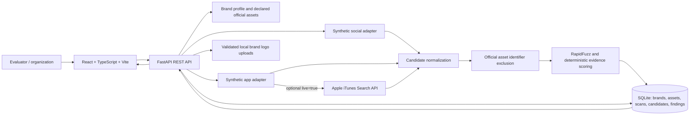

# Architecture

FastAPI exposes `/api/health` and OpenAPI at `/docs`. In development Vite proxies `/api` to FastAPI. After `npm run build`, FastAPI serves the production React build from `frontend/dist`. SQLite stores application records; uploaded image files are stored locally under the ignored `uploads/` directory.
